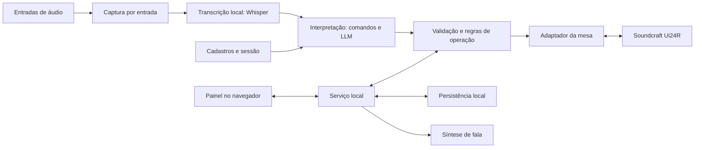
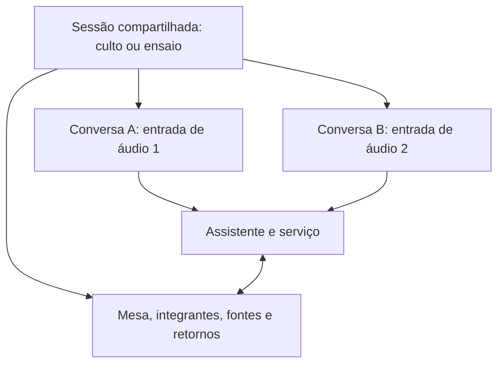
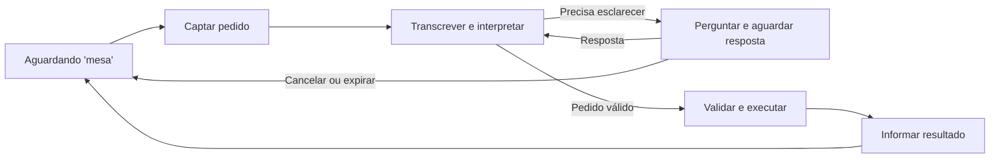
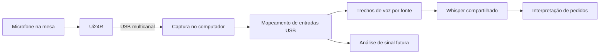
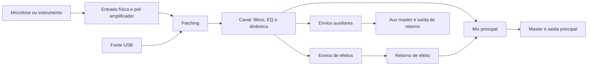
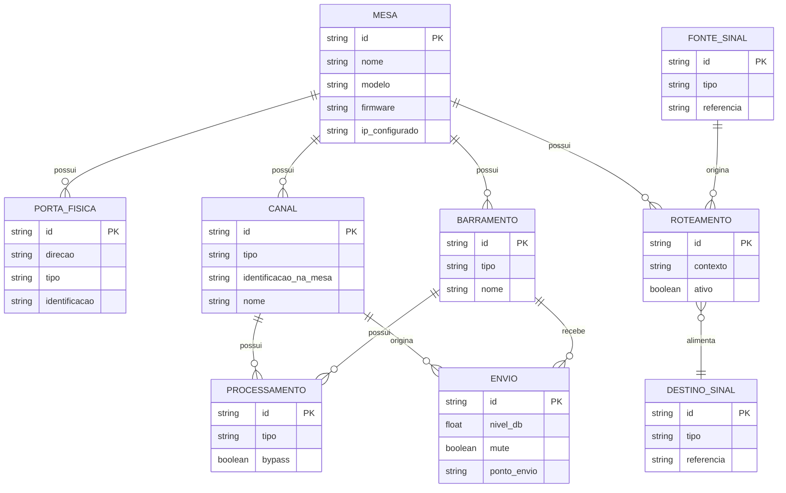
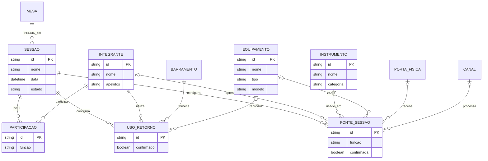
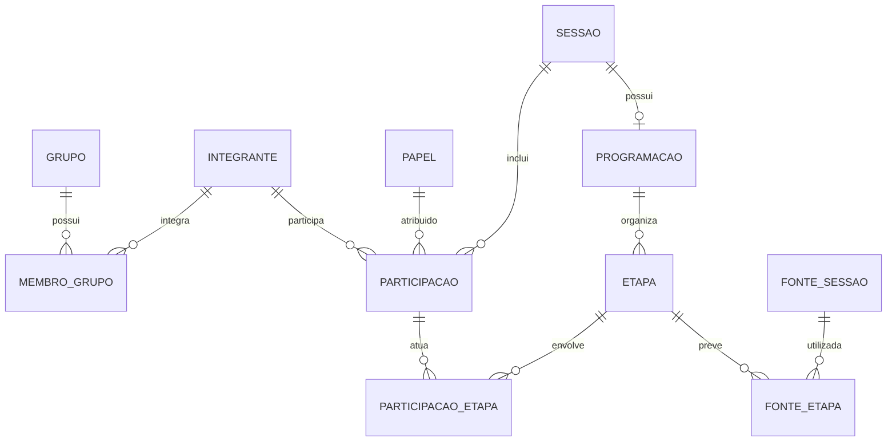
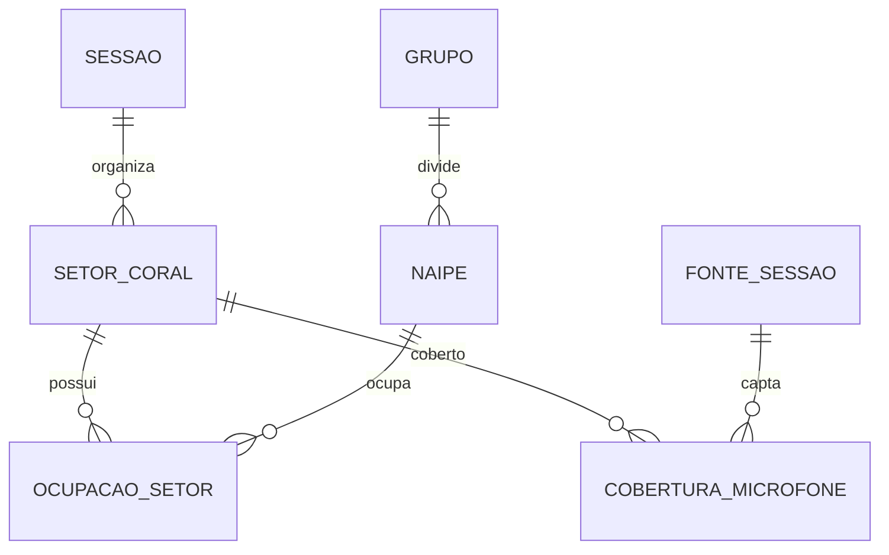
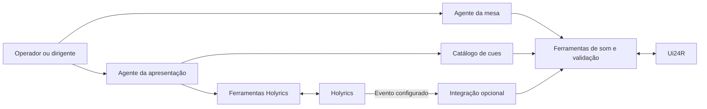

# Arquitetura e visão do projeto

Este documento reúne a visão proposta para o assistente de som e serve de ponto de partida para as decisões de implementação. Ele descreve funcionalidades planejadas, não funcionalidades já disponíveis no protótipo.

## Visão

Criar um assistente para a Soundcraft Ui24R que ajude a equipe de louvor e o operador a configurar e controlar o som por uma interface web e por voz. O sistema deve conhecer a configuração de cada ensaio ou culto, interpretar pedidos em português e fornecer feedback sobre o que entendeu e executou.

O protótipo já validou o caminho de captura de voz, transcrição pelo Whisper e envio de comandos à mesa. Atualmente, ele funciona pelo terminal e implementa mute e fader dos canais de entrada no mix principal.

## Arquitetura proposta

### Tecnologias iniciais

Manter **Node.js como serviço principal** e **Python para captura de áudio e faster-whisper**. A conexão atual com a Ui24R utiliza a biblioteca comunitária `soundcraft-ui-connection` em Node.js e permanece como ponto de partida. Go e Rust poderão ser reavaliados se houver uma necessidade demonstrada; não há migração planejada neste momento. A troca da linguagem do serviço, por si só, não elimina a espera pela gravação ou pela inferência do Whisper.

O Node.js será responsável pelo painel e sua API, persistência, conexão com a mesa, regras e modos de operação. O Python será responsável pela captura e transcrição. A proposta inicial é manter o processo Python e o modelo carregados durante a operação, com mensagens estruturadas por entrada e saída padrão entre os processos; o protocolo deve permitir identificar pedidos, resultados e erros. Eventos em tempo real para o painel podem usar WebSocket local. Essas escolhas de comunicação ainda precisam de validação na implementação.

Para iniciar com o Windows sem intervenção manual, deve-se verificar se o computador entra automaticamente em uma sessão de usuário ou se o aplicativo precisa funcionar antes de qualquer login. Uma tarefa no login pode atender ao primeiro caso; uma tarefa na inicialização ou um serviço do Windows pode atender ao segundo. Em qualquer opção, testar acesso ao driver e aos dispositivos de áudio no contexto real de execução, assim como inicialização sem janela de terminal e recuperação após falhas. O painel é uma interface separada do processo em segundo plano. **A forma definitiva de instalação ainda não foi escolhida.**

- **Serviço local:** inicia com o Windows, mantém a conexão e pode continuar funcionando com o navegador fechado. A forma de instalação e o comportamento de início de sessão ainda serão definidos.
- **Painel web:** configura o IP da mesa, entradas de áudio, integrantes e sessão; mostra conexão, comandos e resultados.
- **Persistência:** guarda configurações, cadastros e histórico entre reinicializações. SQLite é uma opção inicial, sujeita à decisão de implementação.
- **Conexão:** informa se está conectada, tentando reconectar ou precisa de configuração. Continua tentando quando a mesa estiver desligada. Comandos feitos durante a desconexão não devem ser executados automaticamente depois.
- **Voz:** captura por entrada, transcrição e resposta falada. Uma primeira versão pode usar mensagens prontas e as vozes do Windows; uma LLM não é necessária para sintetizar fala.
- **Interpretação:** comandos existentes podem coexistir com uma LLM para frases mais naturais. Um servidor MCP é uma possibilidade para expor ferramentas específicas; uma camada de validação deve conferir referências, limites e necessidade de confirmação antes de qualquer ação.

### Conexão com a LLM e custos

O serviço deve acessar a LLM por uma interface interna de provedor, permitindo avaliar alternativas sem atrelar o restante do projeto a um fornecedor. Um SDK ou cliente de API pode enviar a transcrição e o contexto necessário e receber intenções ou solicitações de ferramentas. O MCP, se adotado, padroniza o acesso às ferramentas; ele não substitui a conexão com o modelo nem as validações do serviço.

As opções a investigar são:

| Opção | Considerações |
| --- | --- |
| API com chave | Geralmente cobra pelo uso separadamente da assinatura do aplicativo; o custo depende do modelo, da quantidade de pedidos e do contexto. Verificar créditos disponíveis, limites e cobrança do provedor. |
| Plano de assinatura elegível | Alguns provedores oferecem integrações oficiais sujeitas a planos, permissões e condições. Na OpenAI, avaliar o fluxo [Sign in with ChatGPT](https://developers.openai.com/siwc/quickstart), sem reutilizar tokens da sessão do navegador. |
| Modelo local | Não há cobrança por requisição ao provedor, mas é necessário avaliar hardware, qualidade, consumo e latência. |

Na OpenAI, assinaturas Pro e Business elegíveis podem oferecer [créditos de API](https://developers.openai.com/api/docs/guides/chatgpt-api-credits) mediante vínculo e condições específicas; esses créditos são distintos dos limites de uso do ChatGPT. As condições e a elegibilidade devem ser verificadas antes da implementação.

A LLM deve ser opcional: comandos básicos podem funcionar localmente sem ela, enquanto pedidos mais complexos podem usá-la. Isso também reduz chamadas pagas. Antes de escolher a opção, estimar pedidos por culto ou ensaio, tamanho do contexto, custo e latência; definir o comportamento quando a LLM ou a internet estiver indisponível. Credenciais devem permanecer no serviço local, fora do código do navegador e do repositório.

### Múltiplas entradas de áudio

A proposta inicial é manter um modelo Whisper carregado e identificar a origem de cada trecho de áudio, começando com uma fila de transcrição. O faster-whisper oferece workers para chamadas concorrentes, mas desempenho, uso de memória e necessidade de paralelismo devem ser medidos no computador real. Uma interface multicanal e vários dispositivos independentes têm requisitos de captura e drivers diferentes. Também é necessário testar sobreposição de vozes, duplicação de comandos e a captação da própria resposta falada.

### Latência, cache e medição

O protótipo atual inicia um processo Python, carrega o modelo e grava cinco segundos para cada comando. A primeira evolução proposta é manter processo e modelo em memória, manter a captura aberta quando viável e detectar o fim da fala em vez de depender sempre de uma gravação fixa. Preservar uma alternativa de ativação manual durante os testes. Comparar `tiny`, `base` e `small`, configurações de transcrição e concorrência usando os mesmos áudios e condições; escolher pelo equilíbrio medido entre atraso, consumo e erros em português.

Registrar por pedido os tempos de fim da fala, detecção de silêncio, transcrição, interpretação, envio, confirmação quando disponível e início da resposta falada. Avaliar mediana e pedidos mais lentos, comandos entendidos, rejeitados ou interpretados incorretamente, além de CPU e memória, com silêncio, música e múltiplas entradas. Uma meta numérica de latência será definida após medir o equipamento real.

Manter em memória o modelo carregado, o contexto da sessão e o último estado observado da mesa. Persistir configurações e vínculos em SQLite, opção inicial a validar. Valores observados devem indicar seu horário e ser sincronizados novamente após reconexão antes de embasar ajustes relativos. Uma resposta de LLM em cache não substitui o estado atual da mesa.

Para comandos reconhecidos com segurança, preferir um caminho local de interpretação e validação; pedidos mais livres podem usar uma LLM opcional. Ambiguidades devem ser esclarecidas. Assim, comandos básicos podem continuar disponíveis sem internet ou LLM, conforme as capacidades implementadas.

### Conversa por voz

A palavra de ativação proposta é **“mesa”**. A pessoa pode dizer a palavra e o pedido na mesma frase, por exemplo: “Mesa, abaixa meu violão no retorno”. O sistema deve detectar o fim do pedido por uma pausa, sem exigir uma palavra de encerramento. Se precisar esclarecer algo, mantém uma janela curta para a resposta sem repetir “mesa”; ao concluir ou expirar essa janela, volta a aguardar a ativação. “Cancelar” deve abandonar a solicitação em andamento. O painel deve indicar quando o assistente está escutando ou processando.

Para a primeira experiência, podemos transcrever trechos e procurar a palavra no texto do Whisper. É preciso medir consumo, atraso e ativações indevidas com música e conversas. Um detector de palavra separado é uma alternativa caso o custo ou a latência sejam inadequados. Se for adotado, deve preservar um pequeno trecho anterior à ativação para evitar cortar o início do pedido. A palavra, a pausa e a duração da janela de resposta devem ser testáveis e configuráveis.

#### Sessão compartilhada e conversas simultâneas

O ensaio ou culto tem uma **sessão compartilhada**, com a configuração da mesa, integrantes, fontes, retornos e estado observado. Cada interação ativa tem uma **conversa separada**, associada à entrada de áudio de origem, com seu contexto temporário: pessoa associada quando conhecida, pedido, pergunta pendente e prazo de expiração. Assim, uma resposta a uma pergunta não deve ser confundida com a conversa de outra pessoa.

O microfone, por si só, não comprova a identidade da pessoa. A associação deve ser confirmada ou atualizada quando necessário. O serviço deve coordenar ações concorrentes sobre o mesmo controle e verificar o estado atual antes de aplicar ajustes relativos, evitando usar valores desatualizados. Também é necessário tratar fala captada em múltiplas entradas, respostas feitas em outra entrada e conflitos de interpretação.

O destino da resposta falada deve ser configurável ou resolvido a partir do contexto; retornos compartilhados podem permitir que outras pessoas ouçam a resposta. Não se pressupõe uma instância do Whisper ou um agente por microfone: modelo e serviço podem ser compartilhados, com contextos separados. A capacidade de processamento simultâneo deve ser medida no computador real.

### Modos de escuta e microfone master

O assistente deve oferecer modos de operação selecionáveis por comandos autorizados ou pelo painel:

| Modo | Entradas habilitadas para comandos | Finalidade |
| --- | --- | --- |
| Passagem de som | Microfones habilitados na sessão, incluindo o master quando configurado. | Identificação, testes e pedidos de ajuste. |
| Culto em andamento | Microfone do dirigente associado à sessão e microfone master, quando configurados. | Restringir a origem dos comandos durante o culto. |
| Escuta pausada | Nenhuma entrada de voz. | Suspender comandos por voz; o painel permanece disponível. |

“Mesa, começar passagem” e “Mesa, começar culto” solicitam as respectivas transições. O painel exibe o modo atual e as entradas habilitadas e permite alterá-los manualmente. Ao mudar de modo, pedidos pendentes de entradas que deixaram de estar habilitadas devem ser cancelados ou pausados com aviso, sem executar respostas posteriores inesperadamente.

O técnico pode configurar uma entrada como **microfone master de comandos**, informando dispositivo, canal e nome. Ela pode permanecer habilitada na passagem e no culto. O microfone do dirigente é associado à sessão e pode mudar a cada culto; se coincidir com o master, representa uma única entrada. As configurações são persistidas e o painel permite recuperar o controle se o microfone master estiver indisponível.

Habilitar uma entrada não comprova a identidade de quem fala nela. As permissões de ações são distintas das entradas habilitadas: definir quais comandos cada origem pode solicitar e quais exigem confirmação ou identificação adicional. A sugestão inicial é permitir a mudança de modo pelo painel e pelo microfone master autorizado; o microfone do dirigente pode fazê-lo conforme a política da sessão. A política definitiva deve ser configurada e validada com a equipe.

Bloquear comandos de uma entrada significa ignorá-los no assistente, não mutar o canal nem interromper seu áudio na mesa. É necessário testar se uma entrada mutada na mesa continua acessível por USB para comandos. Também resta decidir se, após reinício do computador, o modo anterior será retomado ou se o sistema aguardará uma escolha no painel.

### Linguagem simples para níveis

Para interações com integrantes, os níveis podem ser apresentados em uma escala de **0 a 100**, sem exigir conhecimento de decibéis. Um pedido como “abaixa dez” representa uma alteração relativa de dez pontos; “coloca em 50” representa um valor absoluto. Se não estiver claro qual foi a intenção, o assistente pergunta. A resposta deve informar o resultado e distinguir comando enviado de valor confirmado.

A conversão entre a escala e os valores da mesa precisa ser definida e testada na Ui24R, com limites por tipo de ajuste. O valor 50 não deve ser descrito como metade do volume percebido: posição de fader, decibéis e percepção sonora não têm uma relação linear simples. Expressões como “um pouco” ou “bastante” podem ser associadas a passos configuráveis, após validação com os usuários. A mesma escala não implica que ganho de entrada, master e envios sejam intercambiáveis: o sistema deve identificar o controle correto antes de agir.

### Áudio multicanal pela USB da Ui24R

A conexão USB entre a mesa e o computador é uma candidata para captar várias fontes separadamente, sem um microfone USB para cada integrante. É um caminho de áudio independente da conexão de rede usada para controlar a mesa. A proposta é selecionar no painel quais canais USB serão escutados e associá-los às fontes da sessão. O vínculo indica a origem do sinal, mas não identifica automaticamente quem está falando.

O manual principal descreve a seguinte ordem dos sinais enviados pela mesa ao computador:

| Entrada USB no computador | Sinal descrito no manual |
| --- | --- |
| 1–2 | Master esquerdo e direito |
| 3–10 | Auxiliares 1–8 |
| 11–32 | Canais de entrada a partir do canal 1 |

O mapeamento informado para a instalação é 11–30 correspondendo às entradas 1–20 e 31–32 à entrada de linha esquerda e direita. Essa correspondência detalhada, o ponto de captação do sinal e o efeito do patching devem ser confirmados na mesa e no firmware em uso, antes de usá-la para endereçar fontes ou tirar conclusões sobre processamento. O manual apresenta a faixa 11–32 de forma mais geral; não devemos presumir que o canal da mesa e a porta física coincidam em todo roteamento.

No sentido inverso, o computador pode enviar áudio pela USB-DAW para canais da mesa mediante patching. Isso pode futuramente permitir que a resposta falada chegue aos retornos, mas o canal e o destino devem ser configurados e testados para evitar realimentação e captura da própria resposta. A HARMAN exemplifica o retorno USB-DAW 31/32 para os canais 23/24; esse patch não é automático e não altera o envio da mesa para gravação. Consulte o [guia oficial de reprodução](https://help.harmanpro.com/en_US/ui-video-manual-series/how-to-set-up-the-ui24r-for-audio-playback-with-a-daw-ableton-live-edition).

No Windows, verificar a instalação do [driver multicanal da Soundcraft](https://www.soundcraft.com/en-US/softwares/soundcraft-multichannel-usb-audio-driver-v3-20), a versão compatível e a API de áudio disponível para a aplicação. O driver, sua exposição no Python e a captura simultânea precisam ser testados no computador real; a presença da mesa na DAW não garante, por si só, acesso aos 32 canais pelo caminho atual do programa. A DAW é útil para conferir o sinal, mas não é um componente obrigatório da arquitetura proposta.

Como teste inicial: identificar a mesa e a quantidade de canais disponíveis; captar uma entrada conhecida e conferir seu número e nível; repetir com duas fontes simultâneas; medir latência e separação; e testar a reprodução da resposta em um destino controlado. A informação sobre alterações dos canais USB 25–32 em mesas em cascata a partir do firmware v3.0 deve ser conferida no complemento correspondente e no equipamento antes de ser considerada no mapeamento.

## Funcionamento geral da mesa

O fluxo abaixo é uma simplificação; a Ui24R oferece patching, opções de pré/pós-fader, subgrupos e matriz. A entrada física e o canal de processamento são entidades distintas: o roteamento pode ser alterado e também pode usar fontes USB.

O canal de entrada pode ter ganho e pré-amplificação, filtros passa-altas e passa-baixas, EQ paramétrico, gate, compressor e de-esser. O fader controla a contribuição para a mixagem; ele é diferente do ganho de entrada. Os envios auxiliares controlam a contribuição individual de cada fonte para uma mistura, enquanto o aux master controla o nível geral dessa mistura. Envios podem ter mute e opções pré/pós-fader. A mesa também possui efeitos, subgrupos, VCAs, grupos de mute e visualização, matriz, shows e snapshots.

Essas descrições se baseiam no [manual da Ui24R](https://www.harmanaudio.com/on/demandware.static/-/Sites-masterCatalog_Harman/default/dwce13b735/pdfs/Soundcraft_ui24r_Manual_V1.0_Web.pdf), especialmente as seções 2.3, 4.3, 5, 5.6 e 8. A [página oficial](https://www.soundcraft.com/en-US/products/Ui24R) disponibiliza complementos para outras versões. É necessário conferir o firmware da mesa e as capacidades de cada tipo de canal antes de definir parâmetros e limites exatos.

## Modelo de domínio proposto

O modelo separa a mesa e seu estado, o mundo físico e a configuração de cada sessão. Os diagramas expressam relações conceituais; não são um esquema de banco definitivo nem afirmam que a integração já ofereça todos os recursos.

### Mesa, canais e roteamento

`FONTE_SINAL` e `DESTINO_SINAL` representam pontos de conexão: por exemplo, uma porta, fonte USB, canal ou barramento, conforme o tipo e as capacidades do equipamento. O desenho lógico concreto e as restrições de roteamento ainda serão detalhados. Um envio representa uma contribuição entre canal e barramento; seu nível é diferente do master do barramento.

### Roteamento de sinais digitais para saídas físicas

O remapeamento de sinais da mesa para suas saídas físicas pode ser exposto à LLM por ferramentas MCP específicas. O MCP é a interface de acesso; as regras de compatibilidade, autorização e execução permanecem no serviço. As ferramentas propostas são:

| Ferramenta | Responsabilidade |
| --- | --- |
| `consultar_roteamento` | Informar o roteamento observado de uma ou mais saídas. |
| `consultar_fontes_disponiveis` | Listar fontes compatíveis com o destino, conforme as capacidades conhecidas. |
| `propor_roteamento` | Validar origem e destino e apresentar a mudança e seus efeitos conhecidos. |
| `aplicar_roteamento` | Executar uma proposta autorizada e confirmada. |

Uma alteração deve identificar a origem, a porta física de destino e o patch anterior conhecido. Como pode trocar o sinal enviado a caixas ou retornos, a proposta deve ser apresentada a um operador autorizado para confirmação antes da execução. Depois, o serviço deve tentar consultar o estado novamente e distinguir **comando enviado** de **roteamento confirmado**. A confirmação e as capacidades da integração dependem de testes com a mesa; se a leitura do estado não estiver disponível, isso deve ser informado.

Exemplo: “Mande o auxiliar 2 para a saída física 4”. O assistente informa o roteamento atual da saída, se conhecido, solicita confirmação e só então tenta aplicar a mudança. Se origem, destino, estado atual ou efeito forem desconhecidos ou ambíguos, deve esclarecer a situação em vez de presumir o patch.

Os blocos de processamento podem conter parâmetros próprios: filtros em Hz; bandas de EQ com tipo, frequência, ganho e Q; gate com threshold e tempos; compressor com threshold, ratio, tempos e ganho de compensação. Os parâmetros efetivamente suportados dependem do canal, firmware e integração.

### Pessoas, equipamentos e sessão

`FONTE_SESSAO` representa um vínculo operacional, como o vocal da Ana em um microfone, entrada e canal. Uma pessoa pode ter várias fontes, um instrumento pode precisar de vários canais e um retorno pode ser compartilhado. Quando uma fonte usa múltiplos canais, pode ser representada por múltiplos vínculos, a serem agrupados na implementação. Os vínculos de entrada e canal devem ser coerentes com o patch observado; não se presume que seus números coincidam.

Identificação por declaração, origem do áudio e reconhecimento biométrico são coisas diferentes. A primeira versão pode pedir o nome e confirmar os vínculos, sem depender de biometria. Um vínculo ainda não confirmado não deve ser tratado como certeza.

### Exemplo de uma sessão

Ana canta no microfone sem fio 3, conectado à entrada física 5 e roteado para o canal 5. Ela também toca violão por uma DI na entrada e no canal 8. Ana e João compartilham o AUX 2. Se Ana pedir para baixar seu violão no retorno, o sistema identifica a fonte, o canal e o auxiliar e ajusta o **envio do canal 8 para o AUX 2**; isso afeta a mistura compartilhada, não apenas Ana.

## Equipes, papéis e programação do culto

Um grupo representa uma equipe recorrente, como uma formação de louvor ou um coral. Seus integrantes e funções habituais podem ser cadastrados, mas a escalação e os papéis efetivos pertencem à sessão: uma pessoa pode participar em funções diferentes em cultos diferentes. O dirigente é o responsável pela equipe e pela programação do louvor na sessão; essa responsabilidade não implica, por si só, permissão para alterar todos os controles da mesa. Permissões de operação são configuradas separadamente para dirigente, técnico, integrantes e outras pessoas.

A programação da sessão contém etapas ordenadas, como abertura, louvor, avisos, mensagem e encerramento. Cada etapa pode indicar responsáveis, participantes e fontes previstas. Microfones podem ser associados a uma função, como avisos, ou a uma pessoa, como o pastor, sem presumir uso exclusivo permanente. Uma etapa prevista não confirma que sua fonte esteja conectada, com sinal ou aberta.

O cadastro começa no painel; importação de agenda ou integração externa pode ser avaliada depois. Durante o culto, o responsável pode indicar a mudança de etapa por voz ou pelo painel. Inicialmente, o sistema apresenta os recursos previstos e solicita confirmação para ações; não se deve presumir que a programação ocorrerá exatamente na ordem planejada.

### Coral e posicionamento dos microfones

Um coral pode ser um grupo com subdivisões por **naipe ou faixa vocal**, como soprano, contralto, tenor e baixo, conforme a organização da equipe. A expressão “tonalidade” pode se referir tanto à faixa das vozes quanto à tonalidade musical: para o posicionamento inicial, registrar o naipe ou a faixa vocal e deixar essa escolha configurável.

Na sessão, registrar setores ou posições aproximadas do coral, participantes ou naipes em cada setor e os microfones disponíveis. Uma fonte de coral pode associar um microfone, sua posição, a entrada e o canal a um ou mais setores ou naipes; um setor ou naipe pode ser captado por vários microfones. Isso representa captação coletiva, sem atribuir automaticamente o sinal de um microfone a uma única pessoa.

O painel pode apresentar um mapa simples do palco e uma lista acessível com os mesmos vínculos. Na passagem de som, o assistente pode orientar o teste de cada setor e registrar observações do técnico. A posição no cadastro é uma referência para planejamento, não prova de que um microfone capta apenas aquele naipe; acústica, distância, vazamento e sobreposição precisam ser avaliados no local. Recomendações de posicionamento ou equalização dependem de testes e aprovação do responsável técnico.

## Shows, snapshots, cues e apresentação

A Ui24R organiza configurações em shows, snapshots e, em firmware compatível, cues. Um show pode servir de contexto para uma equipe ou apresentação; snapshots podem representar configurações mais amplas; cues podem guardar mudanças mais pontuais para uma etapa ou música. Grupos de mute são outro recurso, útil para atuar sobre conjuntos de canais. A associação entre uma música e uma configuração deve considerar também grupo, formação ou sessão, pois a mesma música pode ter arranjos diferentes.

Cues foram introduzidos no firmware 3.0. Antes do uso, conferir a versão instalada, o escopo efetivo de cada recurso e os parâmetros isolados. Alterações amplas de snapshot podem ser perceptíveis durante a apresentação. Ver o [guia oficial de shows, snapshots e cues](https://help.harmanpro.com/en_US/ui-video-manual-series/%E2%80%8B%E2%80%8B%E2%80%8B%E2%80%8B%E2%80%8B%E2%80%8B%E2%80%8B%E2%80%8B%E2%80%8B%E2%80%8B%E2%80%8B%E2%80%8Bcreating-shows-snapshots-cues-with-soundcraft-ui-mixers).

### Responsabilidades e integração com Holyrics

O **agente da mesa** auxilia o técnico a consultar, criar, atualizar e carregar cues e outras configurações de som, quando essas operações forem suportadas. O **agente da apresentação** cuida de músicas, programação e gatilhos do Holyrics. Um catálogo disponibilizado pelo serviço de som permite ao agente da apresentação consultar cues e propor vínculos, sem precisar conhecer o protocolo da mesa.

O fluxo proposto é: o técnico ajusta a mesa e solicita salvar um cue; o agente da mesa apresenta e confirma a operação; o serviço disponibiliza o cue identificado em catálogo; o agente da apresentação propõe vinculá-lo a uma música ou etapa; e o operador revisa o vínculo e a política do gatilho. Criar um cue e atualizar um existente são operações distintas; alterações e carregamentos devem respeitar as permissões, confirmações e limites definidos para a sessão. Estado enviado e estado confirmado devem permanecer distintos.

O Holyrics oferece gatilhos e scripts e pode também comunicar-se diretamente com a mesa. A integração proposta prefere, quando habilitada, que o gatilho informe um evento ao serviço de som, que resolve a associação e aplica as regras de áudio. A política por vínculo pode ser apenas informar, solicitar confirmação ou executar uma ação previamente aprovada. Uma música exibida ou selecionada não prova que a apresentação começou naquele instante: primeiro testar o momento do gatilho em modo informativo. Uma regra determinística não exige uma chamada à LLM.

Os sistemas devem funcionar separadamente quando a integração estiver desligada ou indisponível. Identificadores e associações devem ser mantidos separadamente em cada domínio, com resultados individuais para cada sistema. Se Holyrics e o serviço controlarem a mesa diretamente, definir o responsável por cada automação para evitar duplicidade e conflitos e acompanhar mudanças externas quando possível.

Ainda é necessário verificar se a integração com a Ui24R permite listar, criar, atualizar, carregar e confirmar cues e snapshots, além de consultar e controlar grupos de mute. Também é necessário verificar quais operações da versão instalada do Holyrics permitem consultar ou alterar gatilhos por API ou script. Até lá, o catálogo e os vínculos podem ser configurados manualmente, sem prometer execução automática.

## Monitoramento e assistência ao operador

O monitoramento do master e, quando disponível, de canais individuais pode mostrar níveis, picos e possíveis problemas ao técnico. Uma camada de medição contínua transforma o sinal em indicadores e eventos; uma LLM opcional interpreta resumos e sugere verificações, sem exigir chamadas contínuas para cada trecho de áudio. Analisar somente o master não identifica com segurança qual fonte causou um problema nem corrige o equilíbrio entre instrumentos.

A evolução proposta é: monitorar e alertar; apresentar sugestões; aplicar mudanças com confirmação; e apenas depois avaliar automação limitada, com controles, limites e testes definidos pelo operador. Uma LLM com latência variável não é mecanismo de proteção instantânea. A disponibilidade de áudio, medições e controles de processamento deve ser verificada na mesa e na integração.

Outras possibilidades a avaliar são uma verificação de pendências antes do culto, perfis de formação revisáveis, histórico e reversão condicionada ao estado atual, diagnóstico guiado e modos de preparação, operação ao vivo, consulta e simulação. O armazenamento de transcrições ou áudio e seu prazo devem ser escolhas explícitas da equipe.

## Estado, ações e histórico

O aplicativo deve distinguir o último estado observado na mesa, o valor solicitado e o resultado da operação. Uma ação pode ser enviada sem que sua aplicação tenha sido confirmada. Como a interface original e outros dispositivos também podem modificar a mesa, o estado observado deve ter horário e ser atualizado quando possível.

O histórico deve registrar solicitação, origem, alvo, valor anterior quando conhecido, valor solicitado e resultado. Reversão depende de conhecer o estado anterior e verificar se ele ainda é aplicável. Pedidos ambíguos, como um retorno não identificado ou um ajuste sem magnitude definida, devem gerar esclarecimento em vez de uma suposição.

## Equalização assistida

O cadastro fornece contexto, mas não determina uma equalização adequada por si só: são relevantes o sinal, o microfone, a fonte, o ambiente e o objetivo do técnico. A evolução proposta é: passagem de som guiada; sugestões com valores atuais e justificativa; e, após validação, aplicação assistida com limites e possibilidade de restaurar valores anteriores. O acesso ao áudio por canal e a capacidade de ler e alterar processamento ainda precisam ser verificados.

## Etapas sugeridas

1. **Base local:** serviço, painel, IP persistido, indicador de estado e reconexão.
2. **Voz e entradas:** modelo carregado uma vez, seleção de entradas, ativação da escuta e testes com múltiplas fontes.
3. **Cadastro e sessão:** integrantes, equipamentos, fontes, canais e retornos, com confirmação dos vínculos.
4. **Linguagem natural:** LLM opcional, ferramentas de consulta e operação e validação das ações.
5. **Passagem de som assistida:** rotina guiada e sugestões de processamento, validadas com o operador.

## Questões e validações pendentes

- Como os microfones chegarão ao computador: interface multicanal, dispositivos separados ou outra forma?
- Qual é o firmware da mesa e quais recursos estão disponíveis nessa versão?
- Para cada controle, a biblioteca comunitária permite ler, alterar, receber atualizações e confirmar o resultado? O manual da mesa não garante essas capacidades na biblioteca.
- Como o serviço iniciará no Windows e quais dispositivos de áudio estarão acessíveis nesse contexto?
- Onde a resposta falada será reproduzida e como evitar que seja captada como comando?
- Qual LLM, local ou remota, será usada, e como o sistema funcionará quando ela estiver indisponível?
- Como obter áudio individual dos canais para análise e equalização?
- A conexão USB multicanal da mesa disponibiliza os canais esperados para a aplicação neste Windows, driver e firmware? Qual é o ponto de captação de cada sinal?
