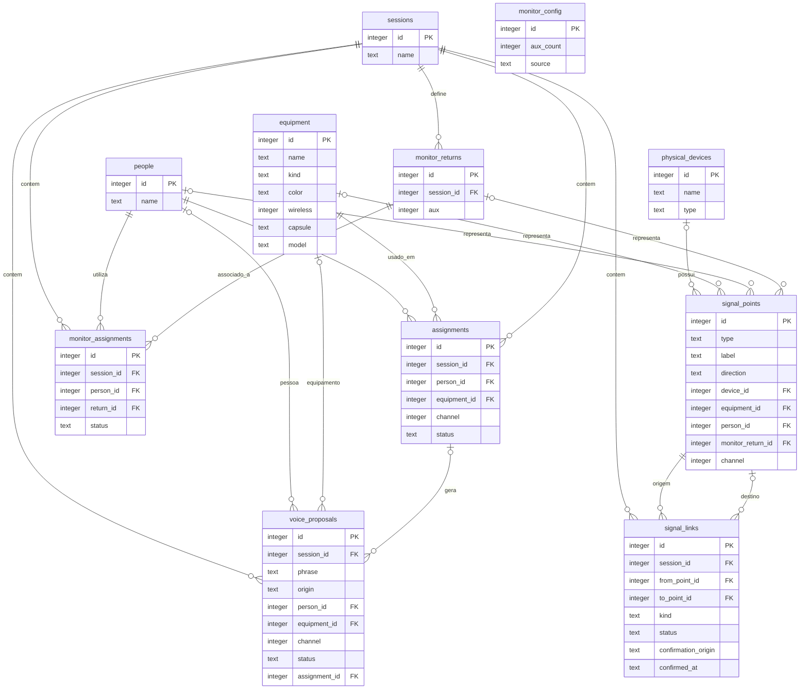
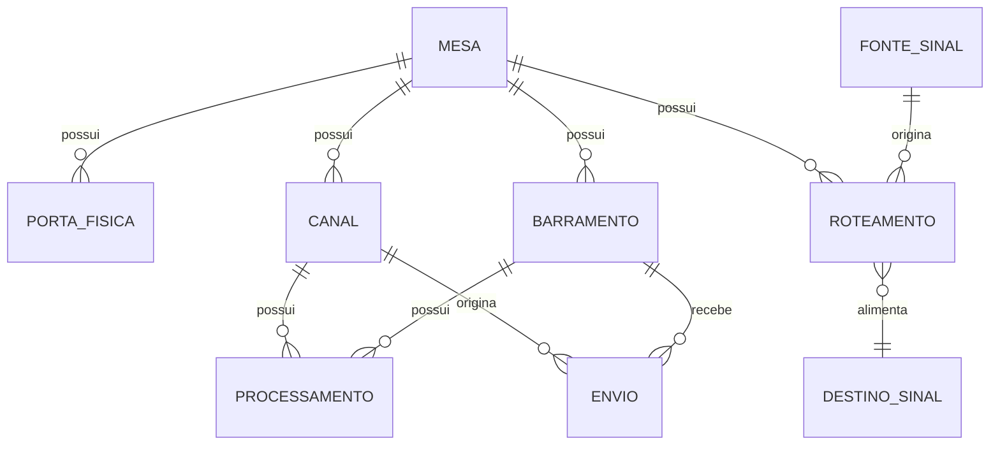
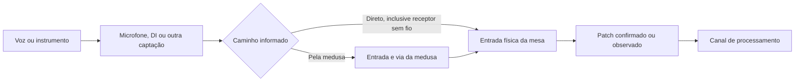
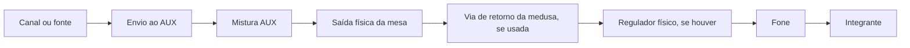
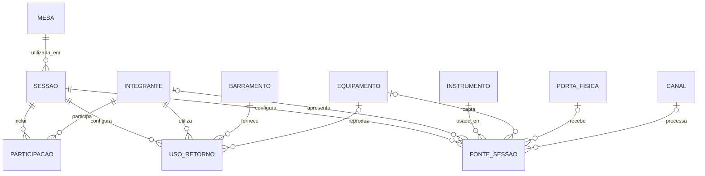
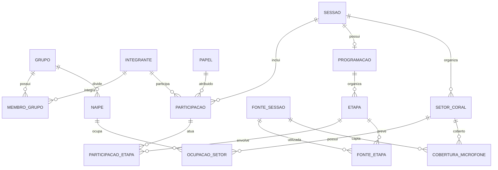
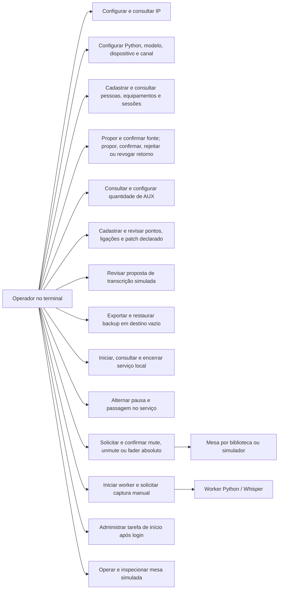
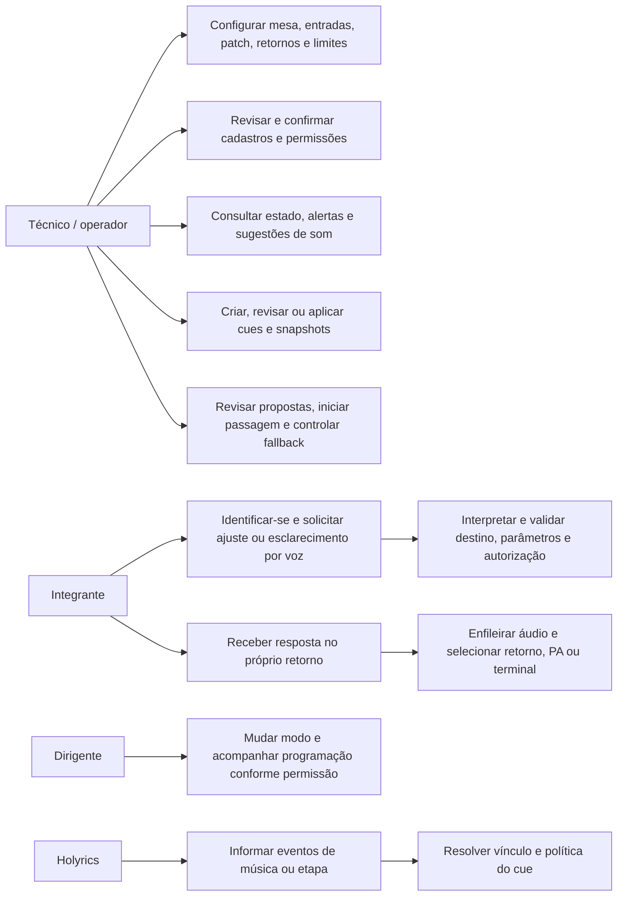

# Entidades e casos de uso

Visão consolidada do que está registrado no código e na [arquitetura](arquitetura.md), revisada em 17/11/2026. Os diagramas separam **implementado**, **simulado/isolado** e **planejado**. O [plano](plano-de-execucao.md) e as especificações detalham critérios e evidências. Um vínculo cadastrado não comprova a ligação física, e um teste simulado não equivale a teste com a mesa.

## Entidades persistidas no SQLite

As onze tabelas abaixo compõem o cadastro no esquema v4. `assignments` registra pessoa, equipamento, sessão e canal declarado; `monitor_assignments` associa pessoa a retorno em uma sessão. Dispositivos, pontos e ligações físicas registram caminhos informados, enquanto `voice_proposals` guarda propostas a partir de transcrições simuladas. A configuração global `monitor_config` não possui chave estrangeira para as tabelas de sessão. Os rótulos nas relações são nomes de domínio, não nomes extras de tabelas.

Um AUX pode ser compartilhado, mas há no máximo um vínculo de retorno confirmado por pessoa e sessão na implementação atual. A contagem de confirmados não comprova exclusividade ou disponibilidade física. O canal de entrada é um número declarado, não uma chave estrangeira para o patch real. Os estados de vínculo de equipamento são `proposto` e `confirmado`; os de retorno incluem também `rejeitado` e `revogado`.

`monitor_config` armazena a quantidade configurável de AUX: um banco legado preserva o valor histórico de oito como não confirmado; um banco novo aguarda configuração explícita. A quantidade informada não detecta a capacidade da mesa. A escolha é feita no terminal; ainda não há instalador que colete essa configuração automaticamente.

IP e configuração do worker de voz ficam em arquivos locais separados; o backup é um arquivo exportado. Estado da conexão, propostas de comando e fila simulada são estruturas em memória: não são tabelas SQLite do diagrama.

## Entidades de domínio planejadas

Os diagramas a seguir são **conceituais**, derivados da arquitetura, e não definem um banco pronto. São complementares às entidades já existentes: por exemplo, uma futura `FONTE_SESSAO` poderá aproveitar informações do vínculo atual, mas isso ainda não é uma migração definida.

### Mesa e fluxo de sinal

Portas físicas, patch, canal, envio e master auxiliar representam elementos distintos. P2/RCA, USB, medusa, regulador e fone são partes do caminho físico a mapear; seus números não são presumidos iguais aos canais da mesa. O processamento pode incluir filtros, EQ e dinâmica, conforme capacidades reais.

### Caminhos pela medusa e características dos equipamentos

**Cadastro implementado; conferência física pendente:** os diagramas abaixo descrevem caminhos que já podem ser registrados como pontos e ligações por sessão. Eles não indicam leitura automática nem controle real desses trechos.

Cor ou etiqueta do equipamento, cor do canal na mesa e identificação da via são dados distintos; nenhuma cor é identificador único. O equipamento possui tipo, cor, opção sem fio, cápsula e modelo; o caminho entre equipamentos, medusa, porta física, patch e canal pode ser cadastrado e consultado, mas é declarado pelo operador. Dinâmico/condensador e com fio/sem fio são características independentes. A posição de um regulador físico não é conhecida pelo serviço.

### Pessoas, sessão e retornos

O caminho pela medusa pode ser registrado como pontos e ligações; sua correção física, o retorno estéreo e a identificação da pessoa pela conversa ainda precisam ser validados ou detalhados. Uma pessoa pode ter várias fontes e um retorno pode ser compartilhado.

### Equipes, programação e coral

### Outros conceitos previstos

Conversas por entrada, propostas de cadastro e revisão, usuários/perfis/permissões, canais/patch observados, histórico de comandos, medições, alertas e sugestões, além de show, snapshot, cue, música, evento Holyrics e vínculo entre sistemas são conceitos da visão do produto. Suas estruturas persistentes e relações concretas não estão todas definidas; não devem ser tomadas como tabelas já criadas. A fila de respostas existe apenas como simulação em memória.

## Casos de uso disponíveis ou implementados de forma parcial

O fluxo do serviço exige confirmação antes de pedir mute/fader à biblioteca e indica que a entrega não está confirmada. O protótipo anterior em terminal possui um caminho `--live` direto, distinto do serviço. A transcrição com modelo e microfone reais, a Ui24R física e a tarefa de login real não foram validadas nesta rodada. Iniciar/instalar a tarefa são ações distintas; os testes do Agendador foram simulados.

Há módulos testados isoladamente para política de modos, palavra de ativação textual, provedor Gemini opcional, validação de propostas, destino de resposta e fila de reprodução simulada. Sua existência não comprova a integração de todas essas peças ao produto; em particular a fila não toca áudio nem opera AUX. No serviço atual, a seleção de modos é pausa/passagem; o modo culto descrito no domínio ainda precisa ser integrado.

## Casos de uso planejados

- Configurar equipes, papéis, coral, equipamentos e programação; identificar fontes e vínculos por conversa, sem inferir identidade só pelo microfone.
- Escutar múltiplas entradas, isolar conversas, ativar por “mesa”, pedir esclarecimento, cancelar e aplicar os modos e permissões definidos.
- Interpretar pedidos localmente ou por provedor opcional; validar deterministicamente alvo, parâmetros e permissão antes de qualquer operação.
- Registrar propostas faladas, revisá-las no terminal e, futuramente, no painel web; receber respostas sintetizadas e roteá-las ao retorno individual. PA automático e limitado é permitido apenas em ensaio/passagem; no culto, falha de retorno resulta em texto ao operador.
- Ajustar envios aos AUX, lidar com retornos compartilhados, grupos de mute, roteamento, cues e snapshots somente conforme capacidades e permissões verificadas; não confundir envio com confirmação física.
- Integrar Holyrics inicialmente em modo informativo; depois resolver vínculos revisáveis e políticas autorizadas, preservando funcionamento independente.
- Monitorar áudio e gerar alertas e recomendações revisáveis. Equalização automática e processamento exigem decisões e validação específicas.
- Oferecer painel web e eventual acesso por rede ou captura via celular apenas após definir autenticação, autorização, proteção da conexão e testes adequados.

As relações, casos e permissões completos continuam sujeitos às decisões e aos testes descritos na arquitetura. O usuário informou que sua montagem utiliza master esquerdo/direito, oito saídas de retorno e saídas de controle, mas o cadastro configurável não deve fixar essa quantidade para todas as instalações.
